## 5. - 9. Mai 2027

**5 Tage in den wunderschönen Salzburger Bergen mit Alex & Lukas**

Träumst du auch davon? Mit deiner Handpan umgeben von Gleichgesinnten und beeindruckender Natur zu spielen? Tiefer einzutauchen in das Handpanspielen, gemeinsam mit anderen zu jammen, dabei deine Komfortzone zu erweitern – und all das kombiniert mit Yoga, Wellness und Bergluft in den Salzburger Bergen?

Genau das machen wir vom **5. bis 9. Mai 2027**. Komm mit uns für **5 Tage Handpan, Yoga und Meditation** ins <a href="https://www.brandgut.at/" target="_blank">brandgut – Resort meets distillery</a> im Glemmtal/Viehhofen, zwischen Zell am See und Saalbach Hinterglemm. Dort waren wir bereits 2025 und 2026 für die Handpan Beginner Days – und 2027 findet hier erstmals auch unser Retreat für alle statt, die schon erste Erfahrungen mit der Handpan gesammelt haben.

<!--
<a href="https://www.brandgut.at/pauschalen/handpan-retreat/" target="_blank" class="button button--primary subscribe-button js-sign-up">Retreat beim brandgut buchen</a>
-->

**Ein Handpan-Retreat inmitten malerisch schöner Natur**

Durch ein achtsames Miteinander, ausgiebig Zeit zum Handpanspielen, Workshops mit inspirierenden Übungen, ein bewährtes Lernkonzept und genügend Zeit für dich selbst hast du die perfekte Umgebung, um deine nächsten Schritte mit der Handpan zu gehen. Tauche tiefer ein in die Magie dieses besonderen Instruments.

  

    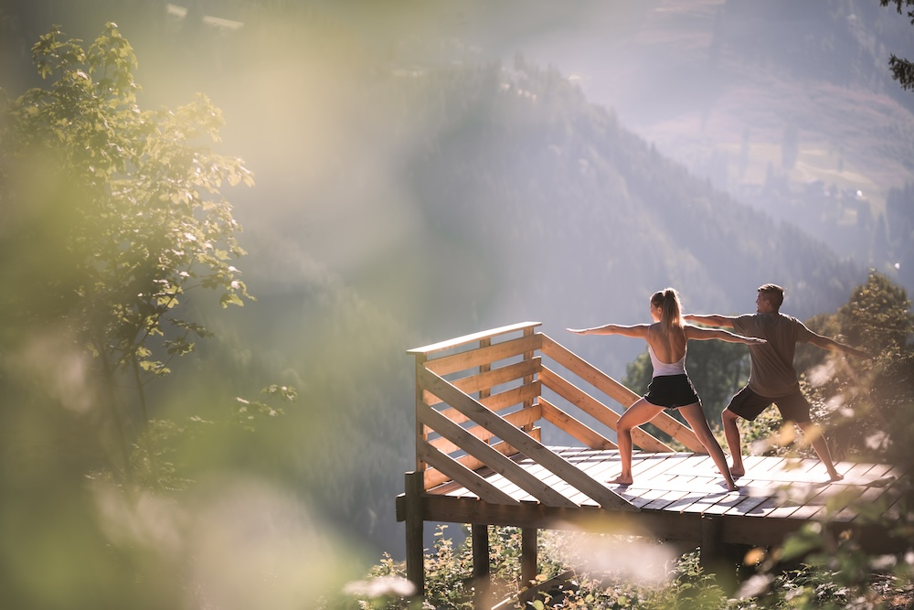
    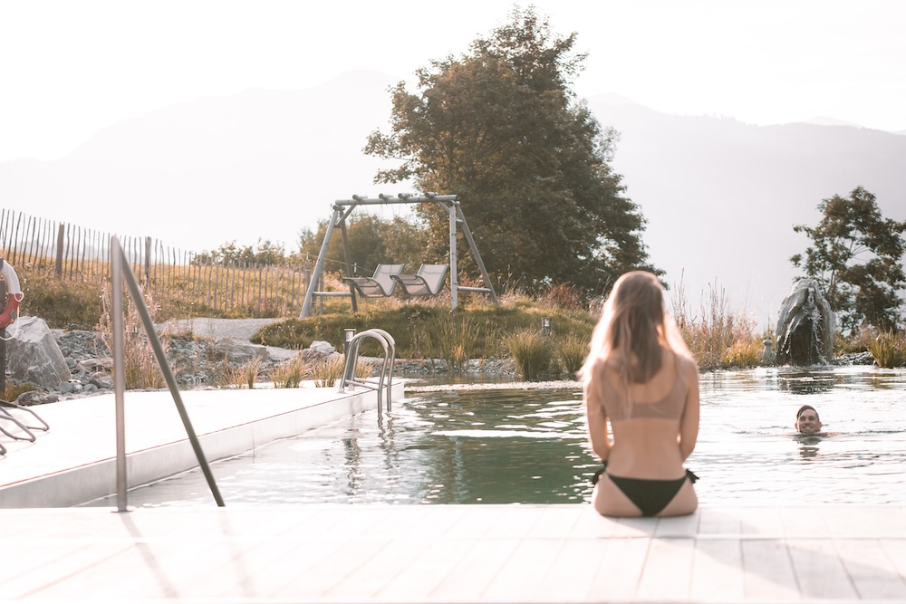
    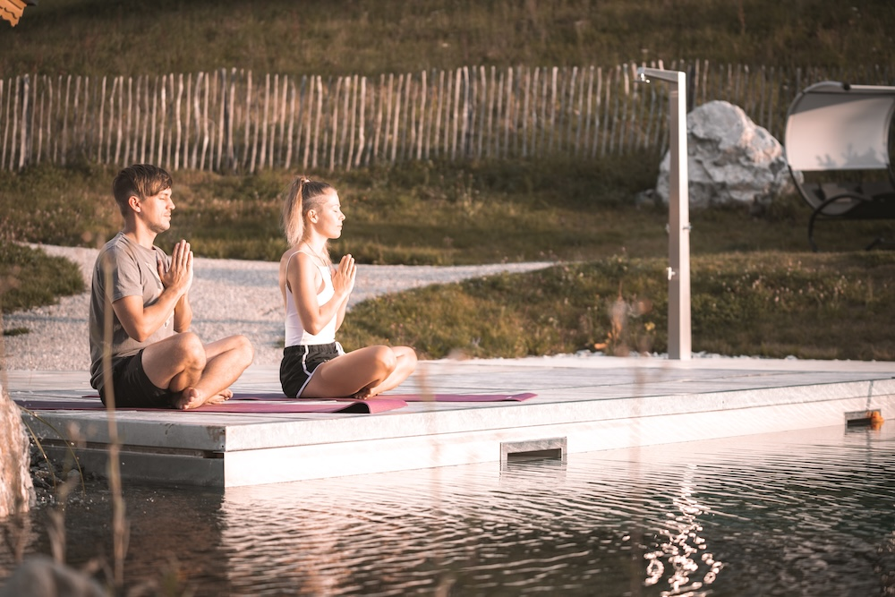
    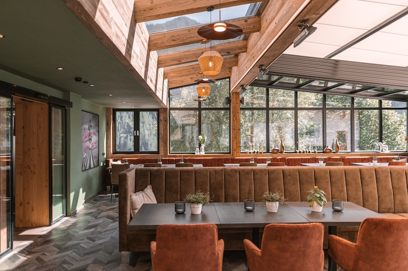
    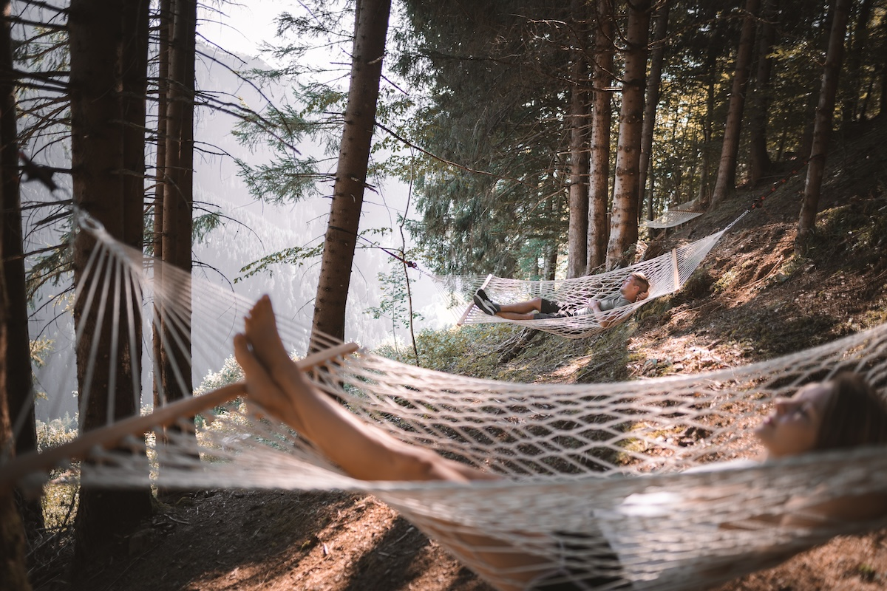
    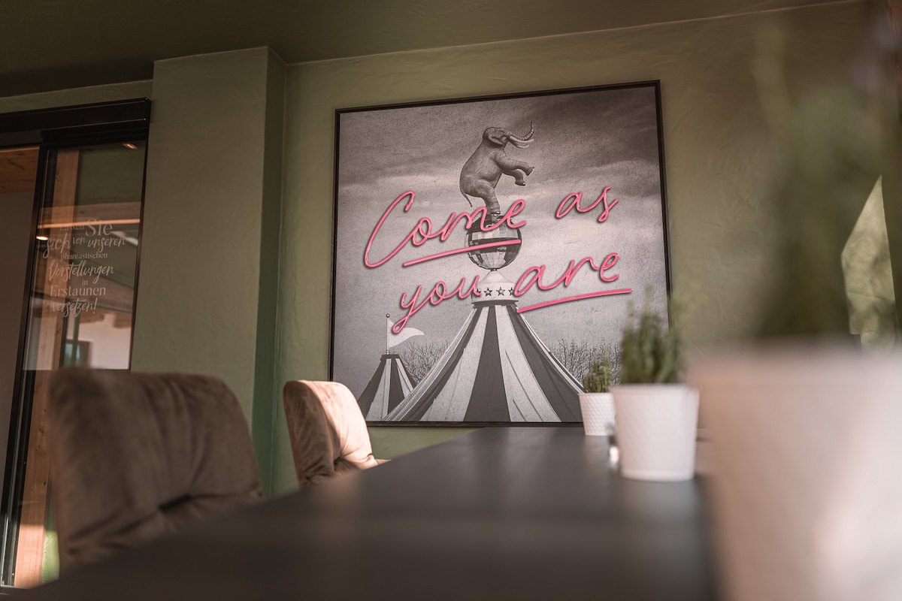
  

  <em>Fotos von <a href="https://www.brandgut.at/" target="_blank">brandgut resort / Ivy Visuals</a></em>

**Für wen dieses Retreat gedacht ist:**

- Wenn du bereits erste Spielpraxis gesammelt hast (z.B. bei unseren Handpan Beginner Days) und nun deine Spielpraxis vertiefen möchtest
- Wenn du neue Impulse suchst, wie du dich von auswendig gelernten Patterns lösen und in deinen eigenen Spielfluss finden kannst
- Wenn du mit anderen gemeinsam Handpan spielen ("jammen") möchtest
- Wenn dir nach einer Auszeit in den Bergen ist, und das am liebsten mit Yoga und Handpan

Falls du noch Anfänger:in bist, dann schau dir unser Retreat im Herbst an: 
<a href="/handpan-beginner-days-2027/">Handpan Beginner Days (vom 30. September - 3. Oktober 2027)</a>

**Was dich in den Workshops erwartet:**

- Gemeinsames Spielen in der Gruppe
- Weitere Rhythmen lernen, wie den Polyrhythmus oder Malte-Beat
- Wie du deine eigenen Patterns formen kannst
- Melodien und Fill-ins üben
- Deinen eigenen Flow im Spielen finden
- Du lernst nach der bewährten <a href="https://www.maltemartenmethod.com/" target="_blank">Malte Marten Method</a>, es wird aber auch genügend Raum sein, um Tipps und Tricks für deine eigene Spielweise und Lieder zu bekommen

**Was 2027 neu ist:**

- Unser Handpan-Retreat findet **erstmals im brandgut** statt – mit Wellness-Bereich, Yoga-Plattform und Blick auf die Salzburger Berge.
- **5 statt 4 Tage**: Viele Teilnehmer:innen der Beginner Days haben sich gewünscht, länger bleiben zu können. Diesem Wunsch kommen wir nach – so bleibt mehr Zeit, um anzukommen, die besondere Atmosphäre in der Gruppe zu genießen und das Gelernte zu vertiefen.
- **Ideal für Wiederkehrer:innen**: Wenn du schon bei den Handpan Beginner Days dabei warst, knüpfen wir genau dort an, wo du aufgehört hast.

**Was dieses Event besonders macht:**

- 5-Tage **Auszeit in den Bergen**, in einer traumhaften Retreat-Location im Glemmtal/Viehhofen – zwischen Zell am See und Saalbach Hinterglemm   (1,5 Stunden entfernt von Salzburg, Kufstein, Chiemsee)
- **Kein eigenes Instrument** notwendig (kann gegen Aufpreis geliehen werden)
- Du wirst wieder die Möglichkeit haben, unterschiedliche **Handpans vor Ort auszuprobieren** (unterschiedliche Skalen + Handpanbauer)
- Handpans von <a href="https://www.paterahandpan.com/" target="_blank">Patera</a> oder <a href="https://yataoshop.com/" target="_blank">Yatao</a> können auf Wunsch **gemietet werden**
- Ein perfekt **aufeinander abgestimmtes Programm** mit Handpan-Unterricht, Yoga, Meditation und Wohlfühlatmosphäre im brandgut wartet auf dich

Veranstalter dieses Komplettangebots ist das <a href="https://www.brandgut.at/pauschalen/handpan-retreat/" target="_blank">brandgut – Resort meets distillery</a> (Viehhofen, Salzburg). Die Buchung erfolgt direkt beim brandgut. Alex und Lukas begleiten dich vor Ort als Yoga- bzw. Handpan-Kursleiter.

### Unser Ablauf

_Mittwoch (Anreise)_

- **15:00 – 17:00** Ankommen
- **18:30** Abendessen
- **20:00** Kennenlernen & Opening Circle mit den ersten Handpan-Klängen

_Donnerstag / Freitag / Samstag_

- **7:30 – 9:00** Yoga (Meditation, Pranayama, Hatha)
- **9:00 – 10:15** Brunch
- **11:00 – 13:00** Handpan-Workshop
- **13:00 – 16:00** Zeit für dich (für eine Wanderung, zum Wellnessen oder zum Vertiefen deiner Handpan-Praxis) – Snacks stehen am Nachmittag zur Verfügung
- **16:00 – 17:00** Freies Spielen (mit Möglichkeit für Fragen)
- **17:00 – 18:00** Handpan-Workshop oder Zeit zum Jammen
- **18:30 – 19:30** Abendessen
- **ab 20:00** Abendprogramm (Spa-Bereich, gemeinsames Jammen oder geselliges Beisammensein)

_Sonntag (Abreise)_

- **7:30** Yoga (Meditation, Pranayama, Hatha)
- **9:00** Brunch
- **11:30** Closing Circle
- **14:00** Offizielles Ende

  

    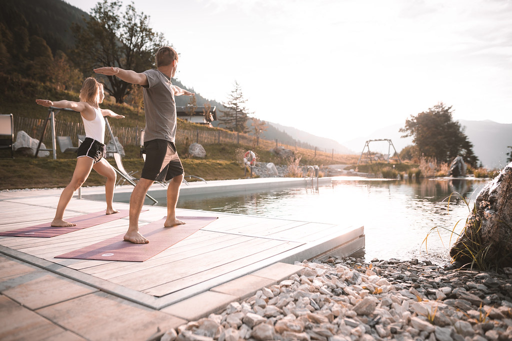
  

  <em>Entspannung + Genuss pur (Foto von <a href="https://www.brandgut.at/" target="_blank">brandgut resort / Ivy Visuals</a>)</em>

### Weitere Infos

Die Handpan-Workshops werden auf Basis der **D-Kurd** Handpanskala unterrichtet. Bitte mit einer D-Kurd in 440Hz kommen oder dir eine ausleihen. Falls du **keine passende Handpan** in der D-Kurd Stimmung hast, kannst du dir für die Tage des Retreats eine Handpan ausleihen.

Da es sich um vertiefende Workshops handelt, werden **folgende Kenntnisse vorausgesetzt**:

- **Mindestens 2 Monate Spielerfahrung**: Du bekommst problemlos Töne aus der Handpan und beherrschst den Anschlag sowohl mit den Fingern als auch mit dem Daumen.
- Sicheres Beherrschen von **Akkordfolgen**: Du kannst wiederholt mehrere verschiedene Akkorde hintereinander spielen und zwischen 2-4-6 und 1-3-5 wechseln.
- Du kannst **Bassnoten und Melodienoten unabhängig voneinander** spielen (Melodiehand + Basshand).
- Falls du Zweifel hast, ob du schon fit genug bist, um an den Workshops teilzunehmen, <a href="https://wa.me/qr/OHNIKZZWK43VC1" target="_blank">melde dich gerne bei Lukas</a>. Auf Wunsch erhältst du im Vorfeld Videos von Lukas, damit du die Grundlagen aus dem Anfängerkurs wiederholen kannst.

Ansonsten sind **keine weiteren Vorkenntnisse** notwendig. Du wirst Schritt für Schritt an die neuen Konzepte herangeführt, und durch die begrenzte Teilnehmerzahl besteht die Möglichkeit, individuell auf dich einzugehen. **Ideal ist dieses Retreat für alle, die seit 1 bis 3 Jahren spielen.** Egal wo du dich gerade auf deiner Reise befindest, wirst du bei diesem Retreat etwas Neues und reichlich Inspiration für dich finden – ob du gerade irgendwo feststeckst, dir die eigene Spielpraxis fehlt oder du gerne mit anderen zusammen spielen möchtest. Wir bauen auf den Grundlagen der Malte Marten Method auf und vertiefen den Zugang zum freien Spielen und gemeinsamen Musizieren (= Jammen).

Für die **Yogastunden** von Alex sind keine Yoga-Vorkenntnisse notwendig. Alex kombiniert klassische Yoga-Stunden mit dynamischen Einflüssen aus dem Animal Flow, um auch hier den spielerischen Aspekt mit in die Yoga-Praxis zu bringen. Sei gespannt!

---

### Unsere Unterkunft

  

    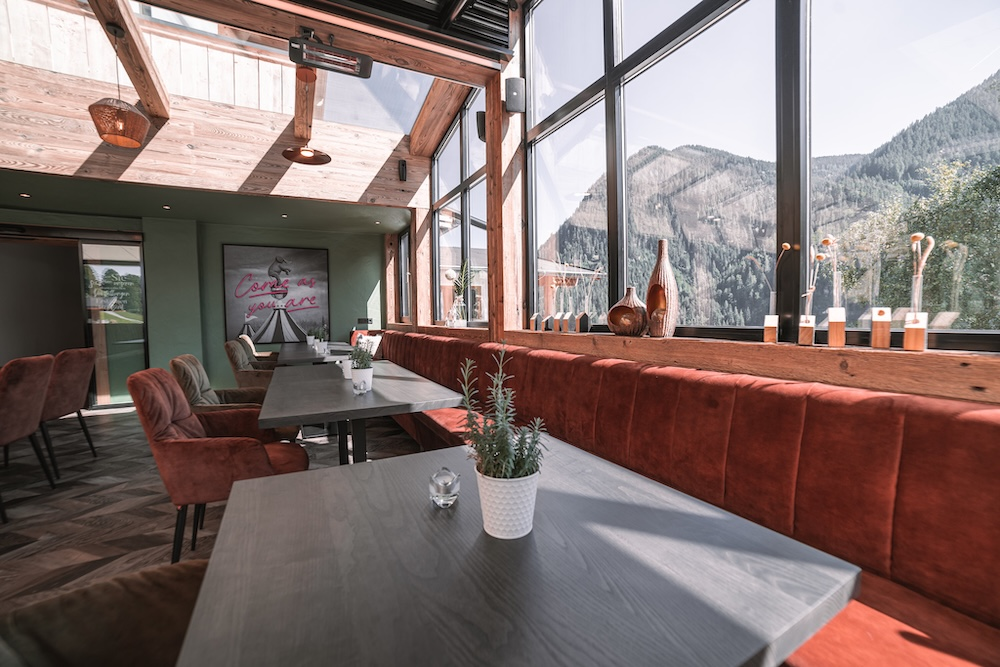
    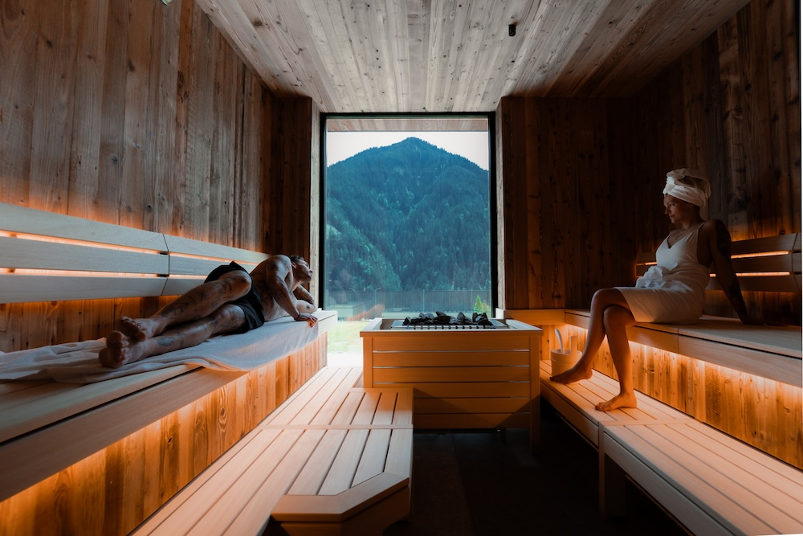
    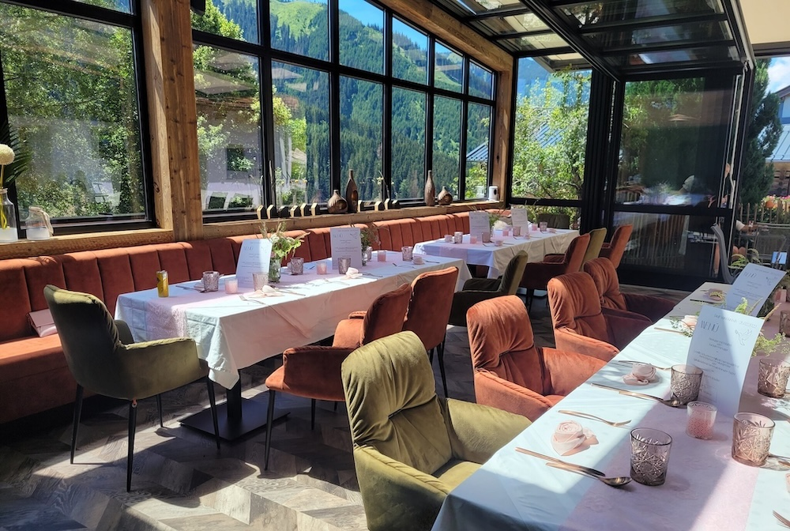
    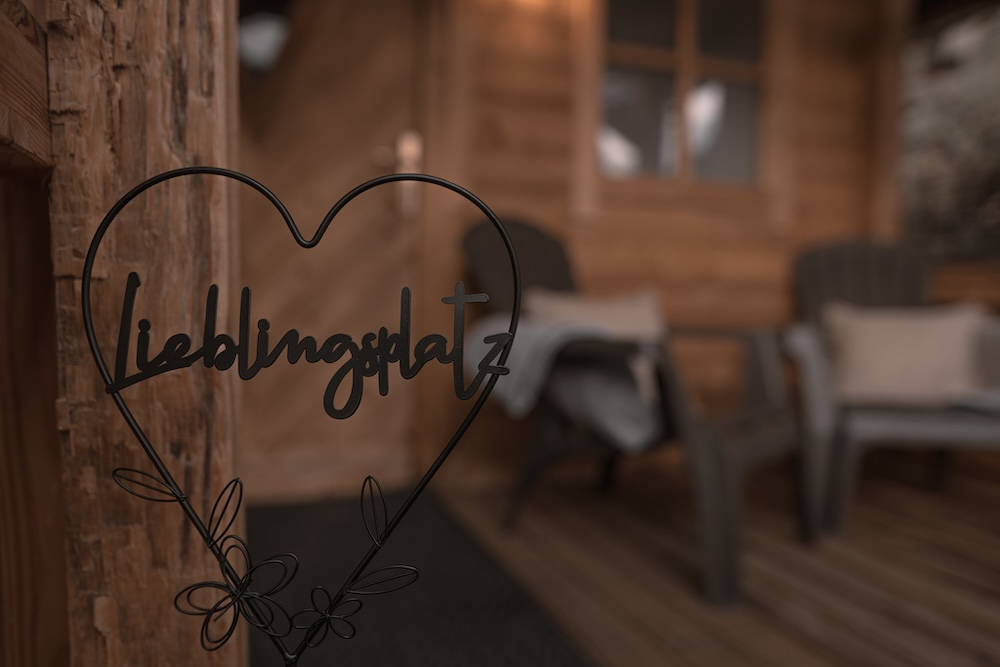
    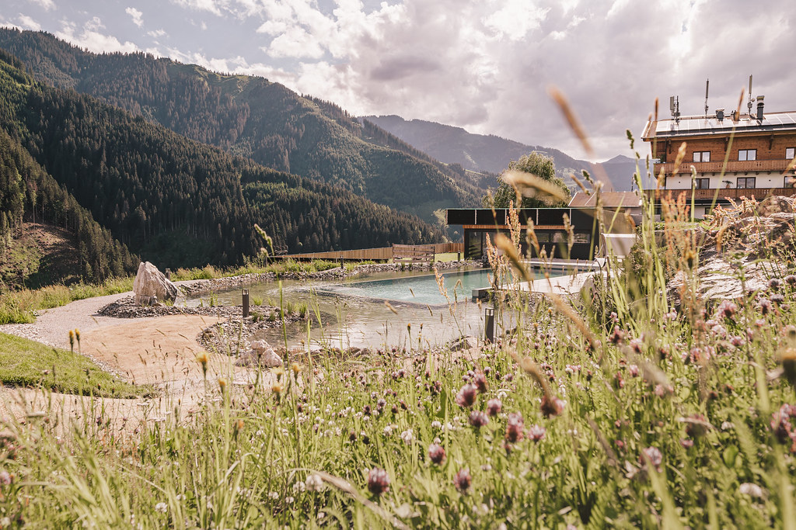
    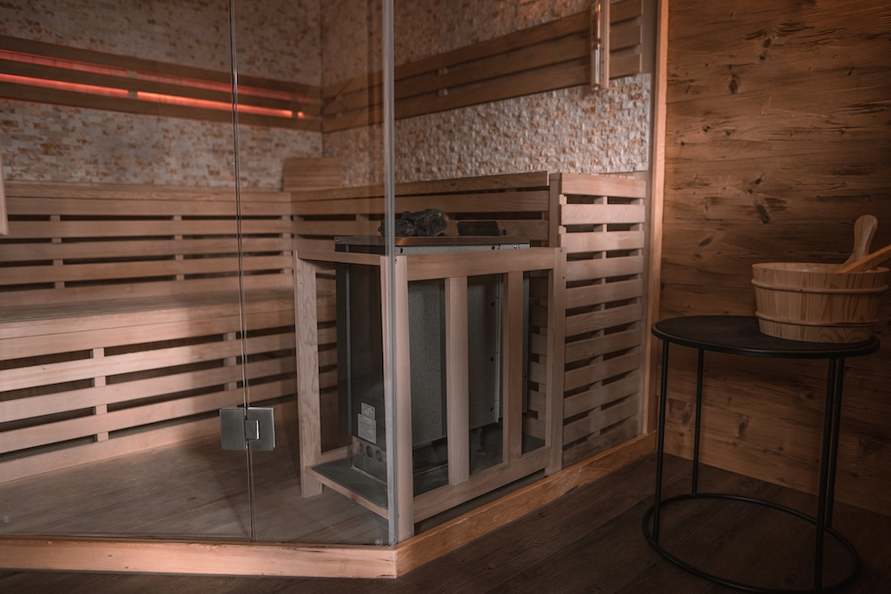
    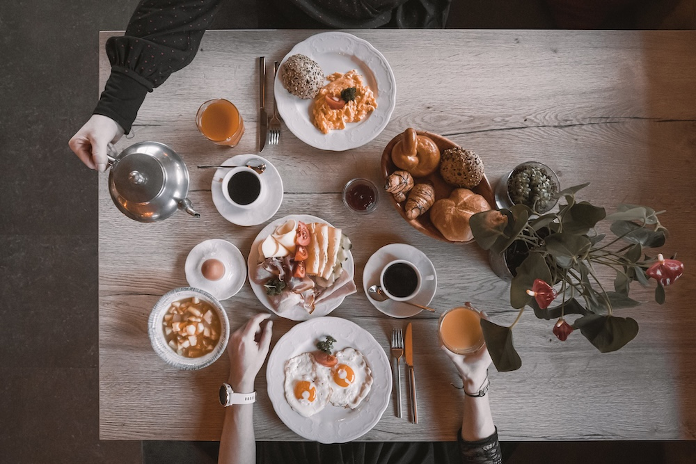
    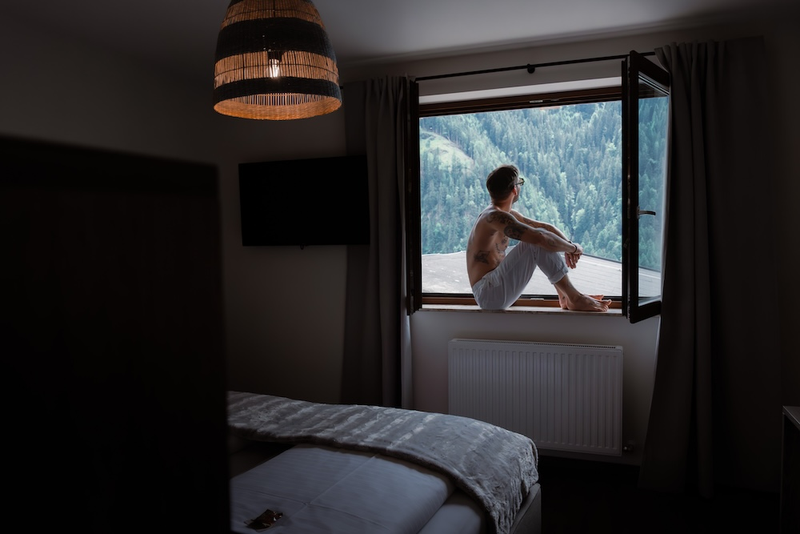
    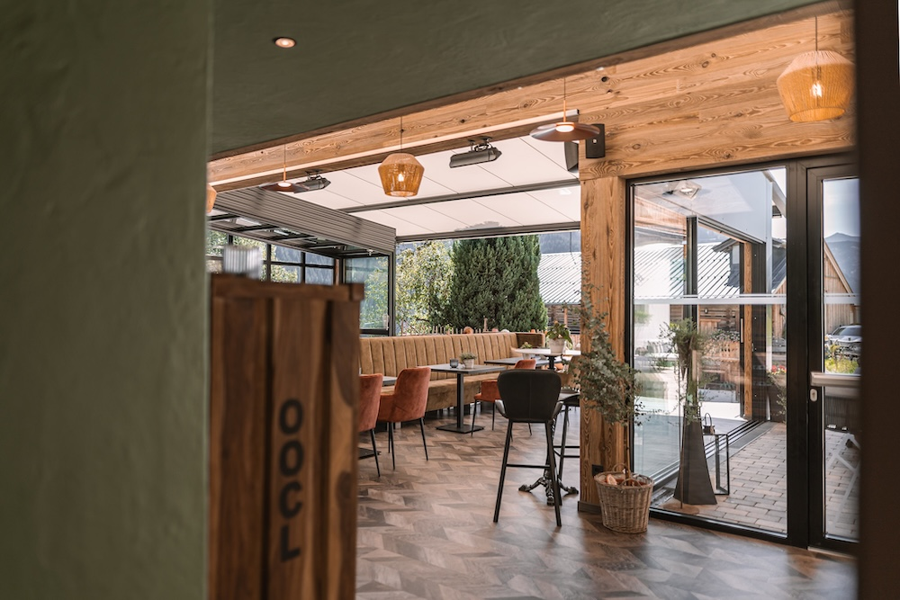
  

  <em>Fotos <a href="https://www.brandgut.at/" target="_blank">© brandgut resort</a></em>

---

### Preis

Das brandgut bietet das Handpan Retreat als Komplettpaket an. Der Gesamtpreis liegt <a href="https://www.brandgut.at/zimmer/" target="_blank">je nach Zimmerkategorie</a> zwischen **1.014 und 1.234 Euro pro Person** und beinhaltet 4 Übernachtungen, Halbpension, Wellness und das gesamte Kursprogramm. Den genauen Preis für dein Wunschzimmer siehst du bei der Buchung direkt beim brandgut.

Optionale **Handpan-Leihgebühr**:
Falls du noch keine eigene Handpan hast, kannst du für **100 Euro** eine Handpan mieten (für die 5 Tage inkl. Versicherung).

<strong id="bring-a-friend">"Bring a Friend" – und spart gemeinsam 💸</strong> 
Melde dich zusammen mit einer weiteren Person an und ihr erhaltet jeweils **50 € Rabatt**.

---

**Im Preis beinhaltet:**

- 4 Übernachtungen mit Wohlfühlatmosphäre im <a href="https://www.brandgut.at/" target="_blank">brandgut</a>
- Halbpension mit Brunch um 9 Uhr, kleinen Snacks am Nachmittag und gemeinsamem 3-Gänge-Abendessen um 18:30 Uhr
- Täglicher Zugang zum Wellness-Bereich des Hotels
- Individuelle 1-zu-1 Betreuung durch Alex und Lukas
- Das gesamte Kursprogramm (mit Handpan-Unterricht und täglicher Meditation + Yoga)

**Im Preis nicht beinhaltet:**

- Getränke sind selbst zu bezahlen (ausg. Brunch, dort sind Tee/Kaffee inklusive)
- Die <a href="https://www.viehhofen.at/de/unterkuenfte/ortstaxe-vertraege#:~:text=Ab%2001.%20Mai%202025%20wird%20diese%20auf%20%E2%82%AC%202%2C20%20pro%20Person" target="_blank">Ortstaxe</a> (Tourismusabgabe) wird bei deiner Ankunft im Hotel bezahlt
- Deine An- und Abreise

**Wissenswertes:**

- Nach der Buchung <a href="https://www.brandgut.at/pauschalen/handpan-retreat/" target="_blank">über die brandgut Webseite</a> erhältst du deine Rechnung über die Gesamtkosten direkt vom Hotel.
- Du kannst ab Salzburg mit den öffentlichen Verkehrsmitteln kostenlos anreisen, außerdem erhältst du die Viehhofen Sommercard.
- Veranstalter dieses Pauschalangebots ist die Brandgut KG (5752 Viehhofen, Österreich). Buchung und Vertragsabschluss erfolgen direkt beim brandgut. Lukas Ziegler (Handpan) und Alex Pichler (Yoga) gestalten das Kursprogramm im Auftrag des Veranstalters.

### Gönn dir eine Verschnaufpause, bevor der Sommer beginnt.

---

> Bist du neugierig geworden?

Dann schau dir auf Instagram die **Highlights der letzten Jahre** an! Im September 2026 waren wir für die <a href="/handpan-retreat-brandgut-2026/">Handpan Beginner Days</a> im brandgut, im Mai 2025 für die <a href="/handpan-beginner-workshop-2025/">Handpan Beginner Days</a> im Navistal und im Mai 2024 für das Ashtanga Yoga & Stille Retreat.

<a href="https://www.instagram.com/stories/highlights/18023731421770010/" target="_blank" class="button button--primary subscribe-button js-highlights">Highlights vom September 2026 – Handpan Beginner Days im brandgut</a>

<a href="https://www.instagram.com/s/aGlnaGxpZ2h0OjE4MDUyMDc4NTIwMzQxMzM0?story_media_id=3622336467137992003_38222413&igsh=MWVwOWtkMWJ5MmVtaw==" target="_blank" class="button button--primary subscribe-button js-highlights">Highlights vom Mai 2025 – Handpan Beginner Days</a>

<a href="https://www.instagram.com/s/aGlnaGxpZ2h0OjE3OTA1MzgzNDM0ODA5NzIy?story_media_id=3363642901962157768_38222413&igsh=MWR2cW1mb2VvNTFseg==" target="_blank" class="button button--primary subscribe-button js-highlights">Highlights vom Mai 2024 – Ashtanga Yoga & Stille</a>

---

### Das sagen unsere bisherigen Teilnehmer über die Zeit mit uns

- "Lieber Lukas, lieber Alex! Von Herzen danke für dieses wundervolle Retreat! Eine liebevolle Organisation, die harmonische Verbindung aus Handpan und Yoga, sowie die achtsame Atmosphäre haben die Tage zu etwas ganz besonderem gemacht. Ich fühle mich entspannt, inspiriert, erfüllt und zutiefst dankbar. Eure Hingabe, euer Feingefühl und eure einzigartigen Skillsets haben es ermöglicht, sich spielerisch Neuem zu nähern, mit Freude und Neugier. Eure Wärme und Passion hat einen heilsamen, perfekt ausbalancierten Raum geschaffen." – Sandra

- "In lockerer Atmosphäre konnte ich mich ganz entspannt ans Handpanspielen herantasten. Lukas und Alex haben dafür Zeit und Raum gehalten. In Kombination mit dem traumhaften Bergblick und dem gemütlichen Hotel war es nicht nur ein Lern-, sondern auch ein echtes Relax-Wochenende."

- "Das Retreat von Lukas & Alex war eine wunderschöne Auszeit. Ich bin ohne große Erwartungen bezüglich dem Handpanspielen hergekommen und möchte jetzt unbedingt weiterspielen! Lukas hat sein Können toll vermittelt & die Yogastunden von Alex waren ein super schöner Start in den Tag! Die beiden haben sehr gut auf die Bedürfnisse aller geachtet und jeder konnte so sein, wie er wollte. Auch die Natur/Umgebung, Unterkunft & Verpflegung waren ein Highlight! Ich komme gerne wieder! Danke!" – Marianne

- "Ein wunderbares Handpan-Retreat für Anfänger! Lukas und Alex haben mit Leichtigkeit und Herzblut eine entspannte und stimmige Mischung aus Yoga und Handpan geschaffen – einfach schön!"

- "Lukas und Alex sind wundervolle, einfühlsame und absolut liebenswerte junge Männer. Sie haben mir beigebracht, wie ich mich abgrenzen und doch öffnen kann und mir klar gemacht, wie dankbar man doch für das eigene Leben sein kann. Ihre Kurse waren übrigens absolut friedlich, lehrreich und sehr emotional. Ich danke euch von ganzem Herzen und umarme euch." – Brigit

- "Ein Retreat mit Lukas und Alex ist sehr heilsam und bereichernd. So eine Achtsamkeit und liebevolle Präsenz, wie man selten erlebt. Sie gehen auf jeden ein und holen jeden da ab, wo er gerade ist. Man fühlt sich wohl und hat genügend Raum, um sich selbst neu kennen zu lernen. Ich kann es absolut empfehlen, in ihrer Gegenwart in Meditation, Yoga und in die Welt der Handpan einzutauchen." – Lana

- "Bitte bietet viele dieser unvergleichbaren Retreats an! Sie bieten so viel Verbesserung durch positive Impulse - das braucht die ganze Welt so dringend!" – Steffi

  

    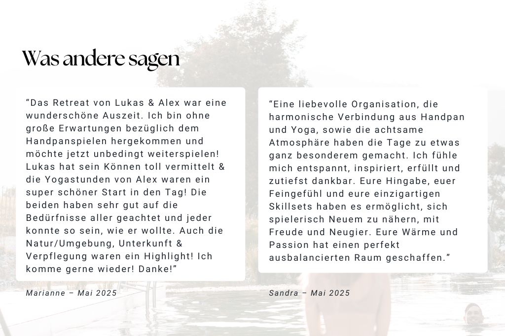
  

  <em>Was Teilnehmer:innen vom Retreat im Mai 2025 sagen</em>

---

### Organisatorisches

- Unsere Unterkunft <a href="https://maps.app.goo.gl/dGYv9zWhLPsHBQ5f7" target="_blank">brandgut resort</a> befindet sich im Glemmtal, auf halber Strecke zwischen Zell am See und Saalbach Hinterglemm, und ist auch **mit den öffentlichen Verkehrsmitteln gut zu erreichen**. Mit deiner Buchung erhältst du eine kostenlose Gästekarte, mit der du im Bundesland Salzburg gratis anreisen kannst. Auch beim Bilden von **Fahrgemeinschaften** unterstütze ich dich gerne und stelle vorab den Kontakt unter euch her.

- Für die Übernachtung gelten die <a href="https://www.wko.at/oe/tourismus-freizeitwirtschaft/hotellerie/agb-hotellerie.pdf" target="_blank">allgemeinen Geschäftsbedingungen der Hotellerie</a>

**Stornobedingungen des Veranstalters (brandgut):**

- **bis 3 Monate** vor Anreise: 0 % vom Gesamtpreis
- **ab 3 Monate** vor Anreise: 40 % vom Gesamtpreis
- **bis 1 Woche** vor Anreise: 90 % vom Gesamtpreis
- in der **letzten Woche** vor dem Ankunftstag 100 % vom Gesamtpreis

- Um Stornierungskosten zu vermeiden, kann ein **Ersatzteilnehmer** genannt werden.

Wir behalten uns vor, in dringenden Fällen das Retreat abzusagen. In diesen Fällen wird das Retreat verschoben und nachgeholt. Der Kunde wird dazu rechtzeitig informiert.

**Dringende Fälle** sind:

- Wird die **Mindestteilnehmerzahl** von 6 Personen nicht erreicht, wird das Retreat vorzeitig abgesagt. Dabei wird der eingezahlte Betrag vom brandgut voll erstattet. Weitergehende Ansprüche entstehen nicht.
- Bei Ausfall der Kursleiter oder bei sonstigen unvorhersehbaren Ereignissen, die ein Durchführen der Veranstaltung unzumutbar erschweren.

---

> Zur Anmeldung oder für Fragen

Die Buchung beim brandgut öffnet in Kürze. Trag dich unten auf die Warteliste ein, dann erfährst du als Erste:r, sobald du deinen Platz sichern kannst – unverbindlich.

<!--
- Anmeldung direkt über <a href="https://www.brandgut.at/pauschalen/handpan-retreat/" target="_blank">die Webseite vom brandgut</a> (dort auf <b>"Jetzt anfragen"</b> klicken),
- oder per E-Mail an <a href="mailto:info@brandgut.at">info@brandgut.at</a>.

<a href="https://www.brandgut.at/pauschalen/handpan-retreat/" target="_blank" class="button button--primary subscribe-button js-sign-up">Retreat beim brandgut buchen</a>
-->

<b>Noch Fragen zum Kursinhalt?</b>

- Melde dich gerne unverbindlich bei Lukas <a href="https://wa.me/qr/OHNIKZZWK43VC1" target="_blank">auf WhatsApp</a>, falls noch Fragen zu Handpan, Yoga oder dem Tagesablauf offen sind.
- Bitte beachte: Buchungen und Zahlungen kann ich nicht entgegennehmen, das läuft ausschließlich über das brandgut.

---

### Wer dich begleitet

#### Lukas

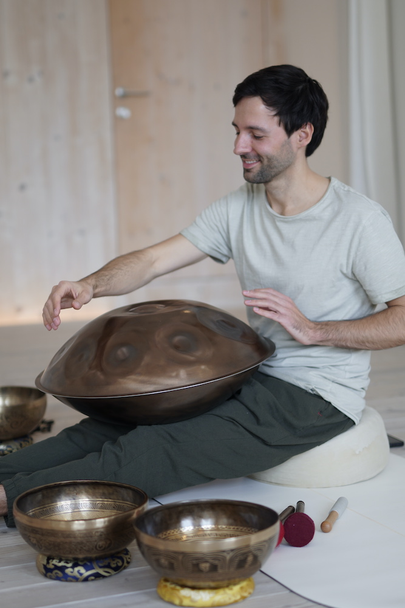
Lukas spielt leidenschaftlich gerne Handpan und baut dies in seine Klangreisen mit ein. Mit viel Begeisterung und Feingefühl unterstützt er dich dabei, deinen eigenen Zugang zum Handpan-Spielen zu finden. Auch er ist noch auf seinem Weg beim Handpan-Spielen besser zu werden, was seine Herangehensweise authentisch und nahbar macht.

Inmitten beeindruckender Berglandschaft lädt Lukas dich ein, innezuhalten, neue Energie zu tanken und deiner Neugierde für dieses Instrument zu folgen. Er schafft eine Atmosphäre voller Leichtigkeit, Vertrauen und Flow, durch die du das faszinierende Instrument der Handpan Schritt für Schritt erlernen kannst. Lukas' Unterrichtsstil basiert auf der <a href="https://maltemartenmethod.com/" target="_blank">Malte Marten Method</a>, wo er auch das dazugehörige <a href="https://www.maltemartenmethod.com/lukas-ziegler-handpan-teacher" target="_blank">Teacher Training</a> absolviert hat.

Erfahre mehr über Lukas auf
<a href="https://www.instagram.com/lukasziegler" target="_blank">Instagram</a> und auf <a href="https://linktr.ee/handpan.with.lukas" target="_blank">Linktree</a>.

#### Alex

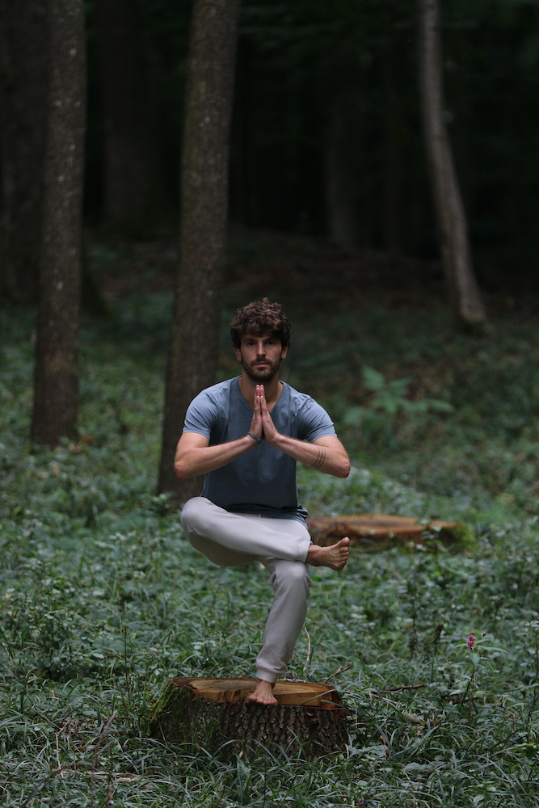

Alex unterrichtet mit Leidenschaft Yoga und bringt Balance, Ausdauer, Kraft und innere Ruhe in seinen Unterricht. Mit einer ganzheitlichen Herangehensweise kombiniert er traditionelles Hatha Yoga mit Praktiken aus dem Yin Yoga und Elementen aus Functional Fitness und Animal Flow. Dabei liegt der Fokus nicht nur auf körperlicher Stärke, sondern auch auf dem Finden der eigenen inneren Ruhe und dem spielerischen Erforschen neuer Bewegungsmuster.

Sein Yoga-Unterricht lädt dazu ein, im Moment zu verweilen, den Atem bewusst wahrzunehmen und den Körper und seine Bewegungen achtsam zu spüren. Besonders die morgendliche Yoga-Praxis dient als energetisierender Einstieg in den Tag – ein Moment der Dankbarkeit, Selbstliebe und Achtsamkeit.

Wir integrieren in den Stunden gezielte Atemtechniken, Mobilisationsübungen und eine ausgleichende Endentspannung, um den Körper zu harmonisieren und die Verbindung zwischen Körper und Geist zu stärken.

Erfahre mehr über Alex auf
<a href="https://www.instagram.com/yogamitalex.pi/" target="_blank">Instagram</a>.

---

  

    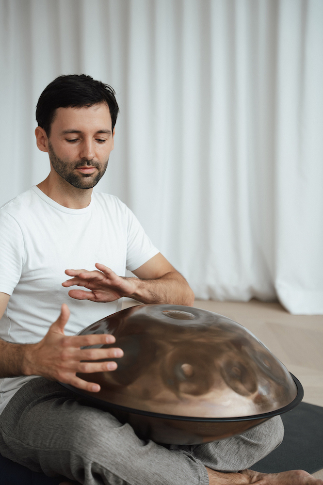
    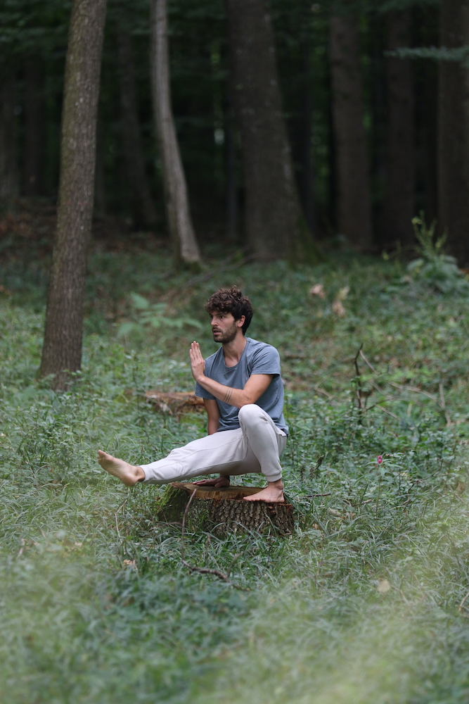
    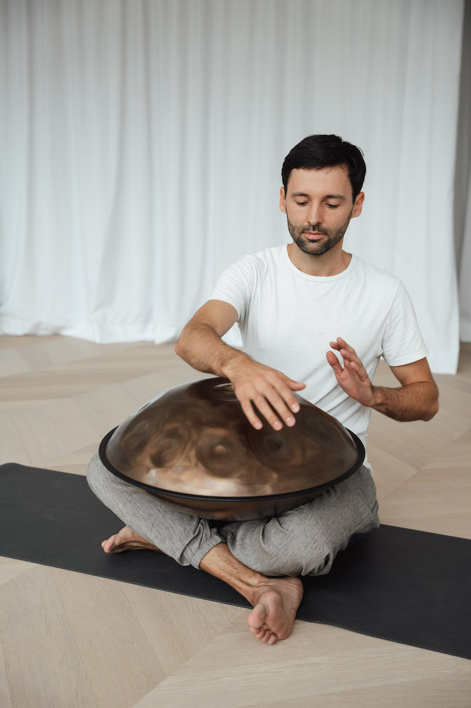
    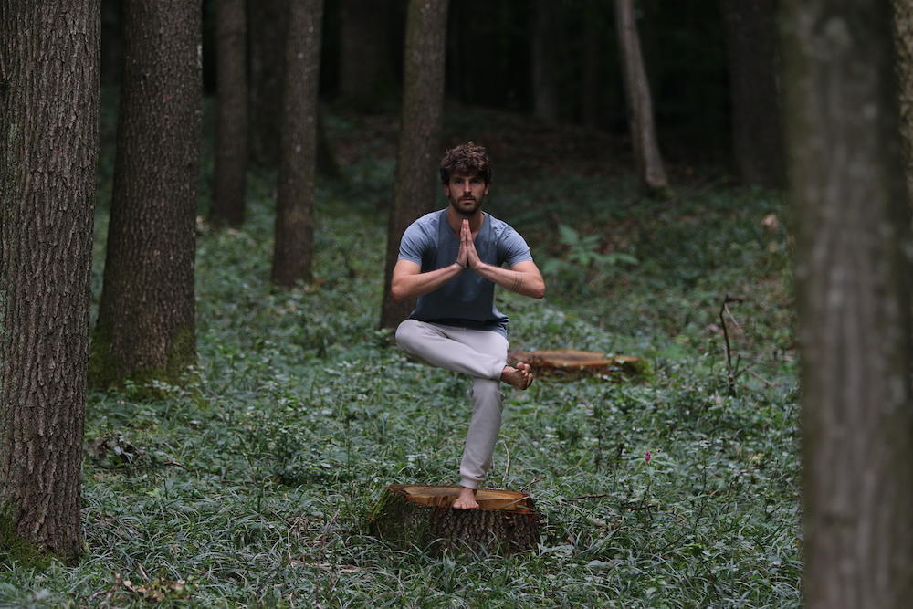
    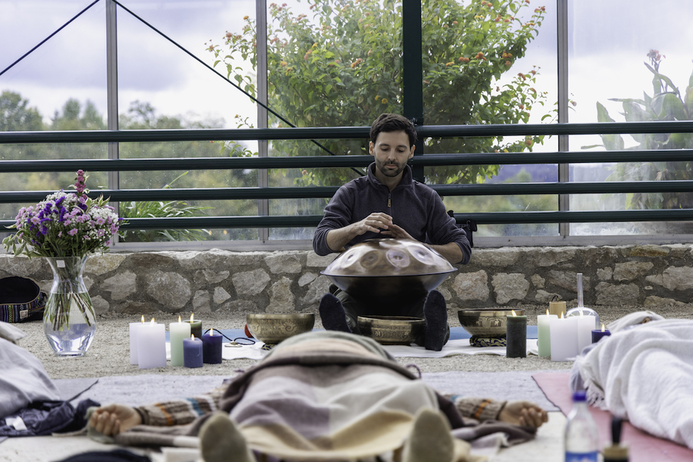
    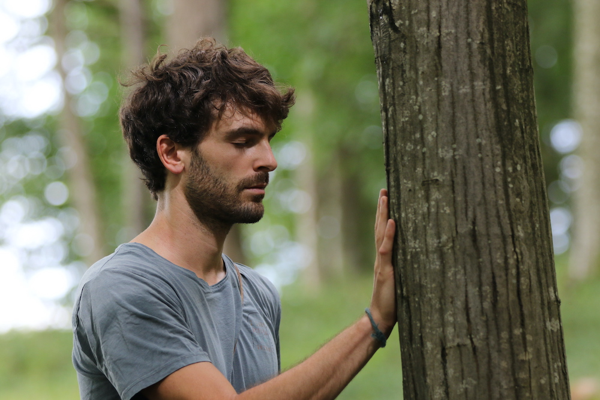
  

  <em>Fotos von Lukas Ziegler (von <a href="https://lumeestories.com/" target="_blank">Ivana Mirkovic</a> + <a href="https://www.instagram.com/johannes_olszewski/" target="_blank">Johannes Olszewski</a>) und von Alex Pichler (von <a href="https://www.instagram.com/saramith_/" target="_blank">Sarah Fritz</a>)</em>

---

### FAQs

> Noch Fragen?

Falls du noch zögerst und dich fragst...

**Q: Ich bin mir nicht sicher, ob ich schon genügend Spielerfahrung habe.**

A: Dieses Retreat ist bewusst für verschiedene Erfahrungslevel gestaltet. 

- Während des Retreats werden wir die Gruppe immer wieder in kleinere Gruppen aufteilen, um individuell auf die jeweiligen Spiellevels eingehen zu können.
- Als grobe Orientierung: _2 Monate bis etwa 3 Jahre Spielerfahrung_ – ideal ist das Retreat, wenn du seit 1 bis 3 Jahren spielst.
- Wenn du bereits mit der Malte Marten Methode lernst und mit dem Konzept von Harmonie-Melodie-Rhythmus vertraut bist oder bereits verschiedene Patterns spielen kannst, bist du bestens vorbereitet.
  Falls du dir die Handpan autodidaktisch oder nach einer anderen Methode beigebracht hast, ist das kein Problem – wir wiederholen die Grundlagen am ersten Tag.
- Wenn du dir trotzdem noch unsicher bist, melde dich gerne <a href="https://wa.me/qr/OHNIKZZWK43VC1" target="_blank">per WhatsApp bei Lukas</a>. In einem kurzen Videocall können wir gemeinsam herausfinden, ob das Retreat etwas für dich ist.
- Mehr Details zu den behandelten Inhalten findest du unter <a href="#weitere-infos">Weitere Infos</a>.

**Q: Ich war schon bei den Handpan Beginner Days. Ist das Retreat das Richtige für mich?**

A: Ja! Dieses Retreat ist der ideale nächste Schritt nach den Beginner Days. Wir knüpfen an die Grundlagen an, die du dort gelernt hast, und gehen tiefer in eigene Patterns, Rhythmen und das gemeinsame Jammen. Und du kennst das brandgut schon – du kannst also direkt ankommen und genießen.

**Q: Ich bin nicht musikalisch.**

A: Viele Teilnehmer denken, sie seien "nicht musikalisch". Die Handpan ist ein leicht zugängliches Instrument, das keine großen musikalischen Vorkenntnisse erfordert. Dieses Retreat ist dafür konzipiert, dass du intuitiv, melodisch und meditativ spielen lernst. Musikalische Vorerfahrungen werden nicht benötigt. Die Workshops basieren auf der Malte Marten Methode, wo es um intuitives Spielen und das freie Kombinieren verschiedener Patterns geht. Es geht vor allem darum, dir zuzutrauen, etwas Neues zu lernen, Spaß zu haben und deine eigene Verbindung zum Klang zu entdecken.

**Q: Warum so lange? 5 Tage sind mir zu viel.**

A: Unsere Erfahrungen der letzten Jahre haben gezeigt, dass viele Teilnehmer:innen bis zu 3 Tage brauchen, um richtig anzukommen – und ab dem 4. Tag oft ein klarer Sprung im Spiel und im Verständnis erkennbar ist. Viele haben sich nach den Beginner Days außerdem gewünscht, noch länger bleiben zu können. Deshalb haben wir uns bewusst für 5 Tage entschieden: So kannst du am meisten lernen und gleichzeitig den vollen Erholungseffekt genießen.

**Q: Ich habe keine eigene Handpan.**

A: Kein Problem! Für die 5 Tage kannst du dir für 100 Euro eine Handpan ausleihen. Wir haben eine Partnerschaft mit Patera & Yatao und bekommen von ihnen D Kurd Handpans geliehen. So kannst du die Tage voll genießen, ohne dir vorab ein eigenes Instrument anschaffen zu müssen. Wenn du Bedarf an einer Leih-Pan hast, gib dies bitte bei deiner Buchung beim brandgut an.

**Q: Ich habe bereits eine Handpan, aber keine D-Kurd. Ist das ein Problem?**

A: Für diese Veranstaltung verwenden wir bewusst Handpans in der D-Kurd-Stimmung, da eine einheitliche Tonleiter das gemeinsame Spielen erleichtert und eine harmonische Klangwelt schafft. Das reduziert die kognitive Last und ermöglicht ein schnelleres sowie effektiveres Lernen.

In der Handpan-Welt hat es sich mittlerweile etabliert, dass alle Teilnehmer – insbesondere in Beginner- und Online-Kursen – mit D-Kurd Handpans spielen. Fortgeschrittene Kurse gehen später auf andere Skalen ein. Falls du keine eigene Handpan in D-Kurd-Stimmung besitzt, kannst du für das Retreat ganz unkompliziert eine leihen. So kannst du dich voll auf die Musik und das gemeinsame Erlebnis konzentrieren.

**Q: Wie läuft das mit dem Yoga? Ist das optional? Welcher Stil wird unterrichtet?**

A: Das morgendliche Yoga dient als bewusster, energetisierender Einstieg in den Tag und ist für alle Teilnehmer eine wertvolle Ergänzung. Es ist vollkommen optional, jeder kann mitmachen – Vorkenntnisse sind nicht erforderlich. Unterrichtet wird Hatha Yoga, kombiniert mit Elementen aus Animal Flow und Functional Fitness, um die Balance, Kraft und Mobilität zu fördern.

---

  

    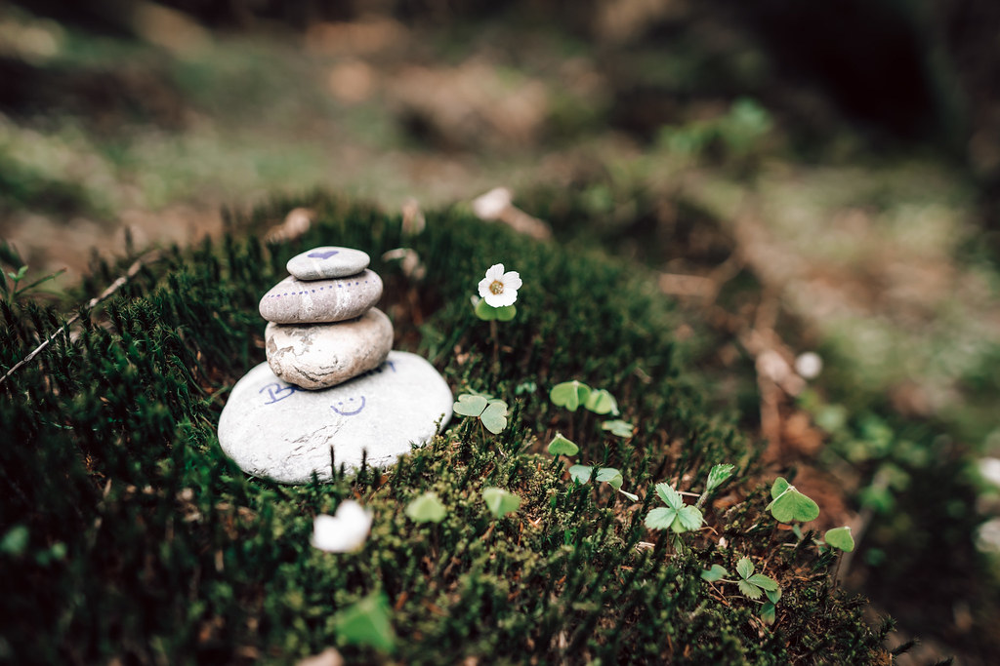
    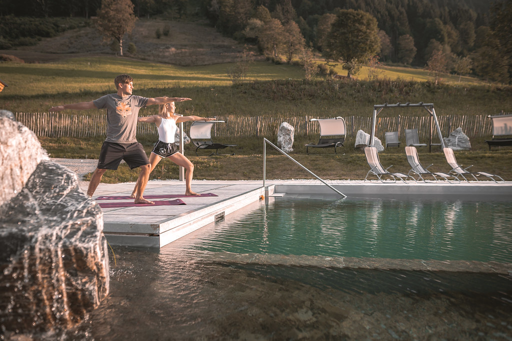
    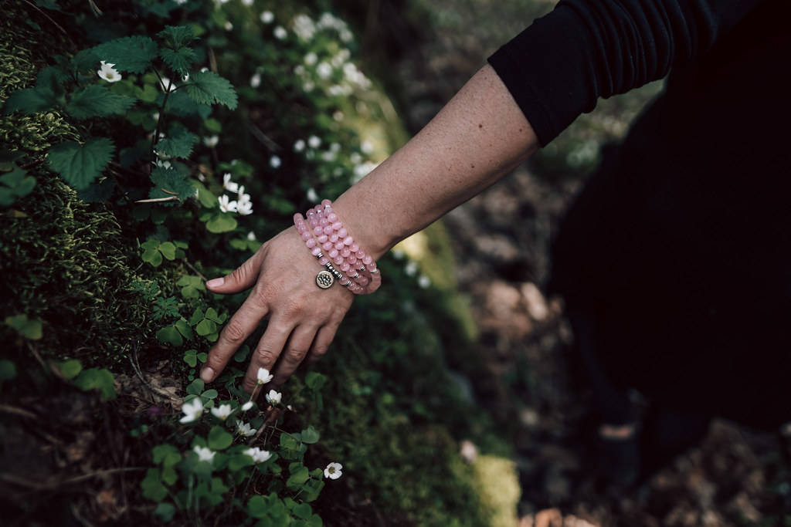
    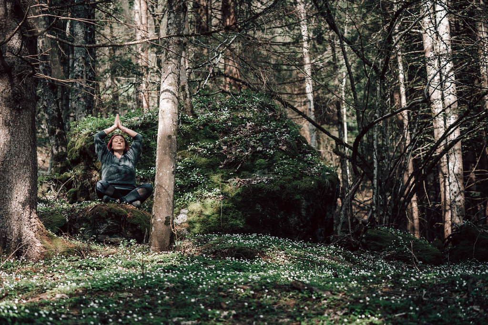
    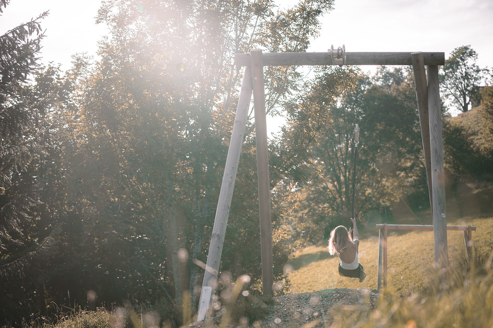
    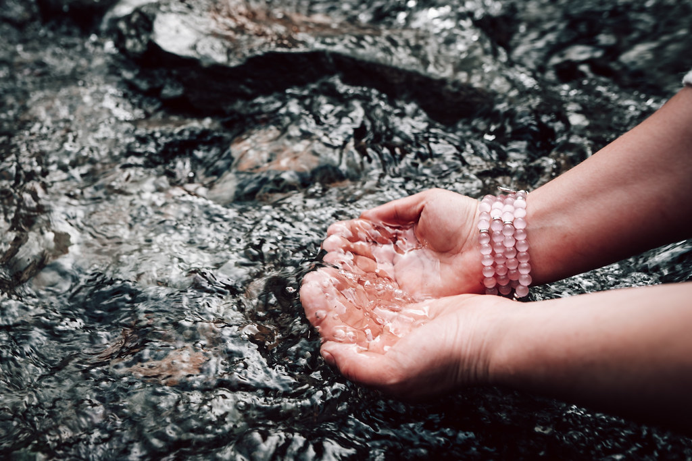
  

  <em>Fotos <a href="https://www.brandgut.at/" target="_blank">© brandgut resort</a></em>

---

## Überlegst du noch?

Melde dich gerne unverbindlich bei Lukas – egal ob du Fragen zum Kursinhalt hast, noch am Abwägen bist oder der Zeitpunkt diesmal nicht passt. Wir führen eine Warteliste für zukünftige Events und melden uns, sobald das nächste ansteht.

> Melde dich bei Lukas auf <a href="https://wa.me/qr/OHNIKZZWK43VC1" target="_blank">WhatsApp</a> oder via <a href="mailto:handpan@lukasziegler.com?subject=Interesse%20am%20brandgut%20Retreat%20im%20Mai" target="_blank">Email</a>.

---

_Diese 5 Tage bieten dir weit mehr als nur ein 1-Tages-Workshop:_

Es ist eine Auszeit vom Alltag – getragen von Klängen, in Gemeinschaft und umgeben von traumhafter Natur. Vertiefe deine Leidenschaft für das Handpan-Spielen und erlebe, wie du dadurch voll im Hier & Jetzt ankommst.

Wir freuen uns auf die Tage mit dir!

## Komm mit 🏔️

<!--
<a href="https://www.brandgut.at/pauschalen/handpan-retreat/" target="_blank" class="button button--primary subscribe-button js-sign-up">Retreat beim brandgut buchen</a>
-->

---

