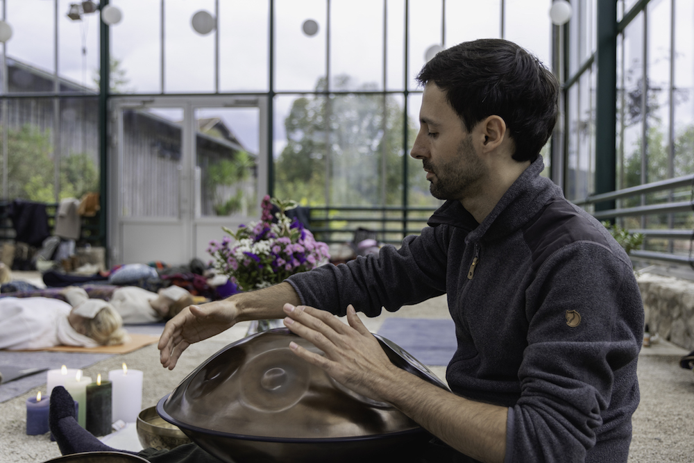

## 17. - 20. Juni 2027

**Zurück zu deiner natürlichen Frequenz**

Vier Tage Bewegung, Klang und Stille in den Bergen: Bei diesem Retreat verbinden wir dynamisches Yoga mit erdenden Klangreisen. Vom **17. bis 20. Juni 2027** sind wir im <a href="https://www.rupertus.at/" target="_blank">Biohotel Rupertus</a> in Leogang – einem familiengeführten Bio-Hotel mit Spa, Blick auf die Leoganger Steinberge und Wald- und Wanderwegen direkt vor der Haustür.

<a href="https://connysturmyoga.com/retreats/yoga-sound-mountains" target="_blank" class="button button--primary subscribe-button js-sign-up">Zur Buchung</a>

**Was dich erwartet:**

- Dynamisches **Morgen-Yoga** mit Fokus auf Alignment und funktionelle Bewegung
- **Abend-Yoga mit live Handpan** und Klangheilung von Lukas
- Optionaler **Handpan-Workshop** zum intuitiven Spielen – im Preis inkludiert
- Achtsame **Wanderungen** durch die Leoganger Steinberge
- **Freie Zeit** zum Ausruhen, Lesen und für den Spa-Bereich
- Kleine Gruppe mit ca. **10–14 Teilnehmer:innen**
- Überwiegend pflanzenbasierte **Bio-Küche**

**Für wen dieses Retreat gedacht ist:**

- Für alle Level – auch Anfänger:innen sind herzlich willkommen
- Wenn du Ruhe suchst und dich in der Natur wieder mit dir verbinden möchtest
- Wenn du Yoga dynamisch, aber achtsam magst
- Wenn du neugierig auf Handpan und Klangheilung bist
- Egal ob du alleine kommst oder mit Freund:innen

### Ablauf

_Donnerstag (Anreise)_

- **ab 15:00** Ankommen & Check-in
- **17:00 – 18:30** Abendpraxis „Root & Release" mit Klang
- **18:30** Willkommens-Abendessen

_Freitag_

- **7:30 – 9:00** Morgenpraxis „Open & Expand"
- **9:00 – 10:30** Bio-Frühstücksbuffet
- Freie Zeit (Spa, Natur, Ausruhen)
- **13:00 – 14:30** Optionaler Handpan-Workshop
- **17:00 – 18:30** Abendpraxis „Twist & Let Go"
- **18:30** Abendessen & geselliger Abend

_Samstag_

- **7:30 – 9:00** Morgenpraxis „Play & Power"
- **9:00 – 10:30** Frühstück
- Freie Zeit
- **13:00 – 14:30** Optionaler Inversions-Workshop
- **17:00 – 18:30** Abendpraxis „Breathe & Lengthen"
- **18:30** Abendessen & Spieleabend (open end)

_Sonntag (Abreise)_

- **7:30 – 8:45** Abschlusspraxis „Rise & Shine"
- **9:00 – 10:30** Frühstück
- **bis 12:00** Verabschiedung & Check-out
- Optional: Wanderung am Nachmittag

<em>Kleine Änderungen im Ablauf sind möglich.</em>

  

    
  

  <em>Foto von <a href="https://www.instagram.com/johannes_olszewski/" target="_blank">Johannes Olszewski</a></em>

---

### Unterkunft & Verpflegung

Wir wohnen im <a href="https://www.rupertus.at/" target="_blank">Biohotel Rupertus</a> in Leogang mit **Vollpension („SinnvollPension")**:

- Reichhaltiges Bio-Frühstücksbuffet
- Nachmittagsjause mit Suppe, Salat-Bowls und hausgemachtem Kuchen
- 5-Gänge-Abendessen mit regionalen, saisonalen Zutaten
- Alpine Bio-Küche mit pflanzlichen Optionen – Allergien und Unverträglichkeiten bitte vorab dem Hotel melden

Je nach Verfügbarkeit gibt es Einzel-, Doppel- und Mehrbettzimmer. Falls du dir ein Zimmer mit einer bestimmten Person teilen möchtest, gib das bitte bei der Buchung an.

### Organisatorisches

- **Preis:** Yoga- & Klangprogramm ab 350 € (Frühbucherpreis bis Ende 2026), zzgl. Unterkunft mit Vollpension im Biohotel ab ca. 650 € pro Person für 3 Nächte – je nach Zimmerkategorie
- **Handpan-Workshop:** im Preis inkludiert, eine Leih-Handpan gibt es vor Ort für 30 €
- **Anreise:** Donnerstag, 17. Juni 2027, Check-in ab 15:00
- **Abreise:** Sonntag, 20. Juni 2027, Check-out bis 12:00
- **Buchung:** Kontakt zum Hotel über <a href="https://connysturmyoga.com/retreats/yoga-sound-mountains" target="_blank">Conny Sturm</a>

---

### Wer dich begleitet

#### Conny

 Conny ist Yogalehrerin in Salzburg. Vor rund sieben Jahren kam sie über die Meditation zum Yoga – Bewegung war für sie aber schon immer ein Weg, bei sich und in ihrem Körper anzukommen, ob beim Tanzen oder beim Sport in der Natur. Heute ist sie Yoga Alliance zertifizierte Lehrerin (500+ Stunden) und unterrichtet nach der Methode des Chromatic Yoga von Matt Giordano, die auch komplexe Haltungen in klare, gut nachvollziehbare Schritte zerlegt.

Ihr Unterricht ist geerdet, kraftvoll und voller Freude, mit Fokus auf intelligenter Bewegung. Besonders liebt sie Alignment, Biomechanik und durchdachte Sequenzen – und übersetzt Anatomie in Anleitungen, die man sofort im eigenen Körper spürt. So entstehen immer wieder echte Aha-Momente. Für dieses Retreat hat sie gemeinsam mit Lukas das Programm gestaltet: zwei Yoga-Einheiten täglich, geeignet für alle Level.

Erfahre mehr über Conny auf
<a href="https://www.instagram.com/connysturmyoga/" target="_blank">Instagram</a> und auf <a href="https://connysturmyoga.com/" target="_blank">connysturmyoga.com</a>.

#### Lukas

 Lukas spielt leidenschaftlich gerne Handpan und baut dies in seine Klangreisen mit ein. Mit viel Begeisterung und Feingefühl unterstützt er dich dabei, deinen eigenen Zugang zum Handpan-Spielen zu finden. Er spielt seit Jahren mit Hingabe, entwickelt sein Spiel stetig weiter und weiß aus eigener Erfahrung, worauf es beim Lernen ankommt – das macht seinen Unterricht fundiert und zugleich nahbar.

Inmitten der beeindruckenden Leoganger Bergwelt lädt Lukas dich ein, innezuhalten, neue Energie zu tanken und deiner Neugierde für dieses Instrument zu folgen. Er schafft eine Atmosphäre voller Leichtigkeit, Vertrauen und Flow, durch die du das faszinierende Instrument der Handpan Schritt für Schritt erlernen kannst. Lukas' Unterrichtsstil basiert auf der <a href="https://maltemartenmethod.com/" target="_blank">Malte Marten Method</a>, wo er auch das dazugehörige <a href="https://www.maltemartenmethod.com/teacher-training/" target="_blank">Teacher Training</a> absolviert hat.

Erfahre mehr über Lukas auf <a href="https://www.instagram.com/lukasziegler" target="_blank">Instagram</a> und auf <a href="https://linktr.ee/handpan.with.lukas" target="_blank">Linktree</a>.

---

## Komm mit 🏔️

<a href="https://connysturmyoga.com/retreats/yoga-sound-mountains" target="_blank" class="button button--primary subscribe-button js-sign-up">Zur Buchung</a>
